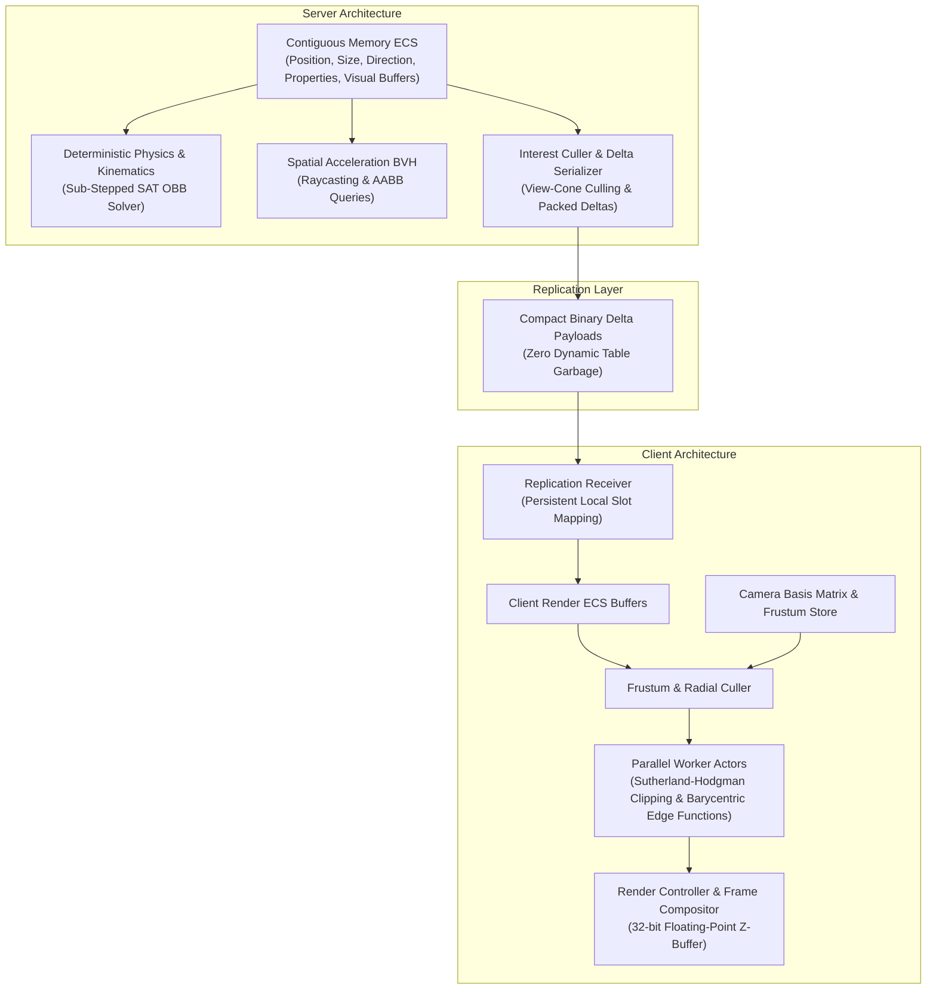

# Antigravity Engine: High-Performance Software Renderer & Systems Pipeline

## Classification & Architecture Overview
- **Engine Type:** Deterministic High-Throughput Software 3D Rasterizer & Physics Engine
- **Target Platform:** Roblox / Luau Native Compilation (`--!native`, `--!optimize 2`)
- **Memory Paradigm:** Data-Oriented Contiguous Memory Byte Buffers with Zero-Allocation Frame Loops
- **Throughput Profile:** 600×600 Native Resolution at 60 FPS (~21.6 Million Pixel Evaluations/sec)
- **Concurrency Architecture:** Multi-Actor Worker Slicing via Parallel Luau VM Threading

---

## Architectural Data Flow



---

## Subsystem Documentation Directory

For in-depth architectural mechanisms, mathematical formulations, and API specifications, explore the system-level guides:

| Subsystem | Location | Description |
| :--- | :--- | :--- |
| **Software Rasterization Pipeline** | [`Render.md`](file:///C:/Users/Startklar/Documents/Development/Roblox/CustomRenderer/src/shared/Utilities/Render/Render.md) | Sutherland-Hodgman clipping, 2D barycentric edge functions, Z-buffering, and multi-Actor worker parallelization. |
| **Physics & Kinematics** | [`Physics.md`](file:///C:/Users/Startklar/Documents/Development/Roblox/CustomRenderer/src/shared/Utilities/Physics/Physics.md) | Semi-implicit Euler sub-stepping, SAT OBB contact resolution, dynamic friction, and mass-weighted impulses. |
| **BVH & Spatial Raycasting** | [`BVH.md`](file:///C:/Users/Startklar/Documents/Development/Roblox/CustomRenderer/src/shared/Utilities/BVH/BVH.md) | Ray/OBB entry-exit interval solving, broadphase AABB bounding queries, and live dynamic OOP entity tracking. |
| **Contiguous Memory ECS** | [`ECS.md`](file:///C:/Users/Startklar/Documents/Development/Roblox/CustomRenderer/src/server/Objects/ObjectsECS/ECS.md) | Flat linear byte buffer layout, 32-bit property bitfield packing, and $O(1)$ free-list entity slot recycling. |
| **Replication & Streaming** | [`Replication.md`](file:///C:/Users/Startklar/Documents/Development/Roblox/CustomRenderer/src/server/Objects/Replication/Replication.md) | Observer view-cone culling, binary delta buffer compression, and persistent client-to-server slot ingestion. |
| **Player Lifecycle Service** | [`Player.md`](file:///C:/Users/Startklar/Documents/Development/Roblox/CustomRenderer/src/shared/Utilities/Player/Player.md) | Renderable ECS player entity registration, `DynamicObjectsList` OOP linking, 20-byte binary transform sync, and local self-collision suppression. |
| **Control-Theory Resource Orchestrator** | [`ControllerTheory.md`](file:///C:/Users/Startklar/Documents/Development/Roblox/CustomRenderer/src/shared/Utilities/ControllerTheory/ControllerTheory.md) | Closed-loop 60 FPS frame-budget PI/PD controller (60% Renderer / 40% Physics), residual `OtherSystemsFrameTime - TargetFrameTime` math, dynamic resolution scaling, and deterministic physics part striding. |

---

## Codebase Organization & Navigation Conventions

The codebase strictly follows standard architectural roles across directories:
- **`Core/`**: Pure computational logic, mathematics, and data definitions without side effects.
- **`Controller/`**: Active state execution, frame loops, and lifecycle coordination.
- **`Scene/`**: Storage management, slot mapping, and resource cleanup.
- **`*Helper.luau` / `*Math.luau`**: Modular extracted functions ensuring zero untracked closures in system orchestrators.

---

## Test Suites & Verification

The project includes dual-boundary automated test coverage executable directly within Roblox Studio or via TestEZ:

- **Server Test Suite:** [`src/server/Tests/TestRunner.server.luau`](file:///C:/Users/Startklar/Documents/Development/Roblox/CustomRenderer/src/server/Tests/TestRunner.server.luau)
  - Specs: `BVH.spec.luau`, `ControllerTheory.spec.luau`, `ECS.spec.luau`, `Physics.spec.luau`, `Player.spec.luau`, `RenderMath.spec.luau`, `RenderTexture.spec.luau`, `Replication.spec.luau`, `ViewCulling.spec.luau`, `WorkerPartition.spec.luau`.
- **Client Test Suite:** [`src/client/Tests/ClientTestRunner.client.luau`](file:///C:/Users/Startklar/Documents/Development/Roblox/CustomRenderer/src/client/Tests/ClientTestRunner.client.luau)
  - Specs: `Camera.spec.luau`, `Cleaner.spec.luau`, `ClientInput.spec.luau`, `ControllerTheoryClient.spec.luau`, `PlayerClient.spec.luau`, `RenderService.spec.luau`, `ReplicationReceiver.spec.luau`, `ReplicationSender.spec.luau`.

---

## Getting Started

To build and sync the place using [Rojo](https://rojo.space/):

```bash
# Build binary or XML place file
rojo build -o "RobloxProjects.rbxlx"

# Start live sync server
rojo serve
```
